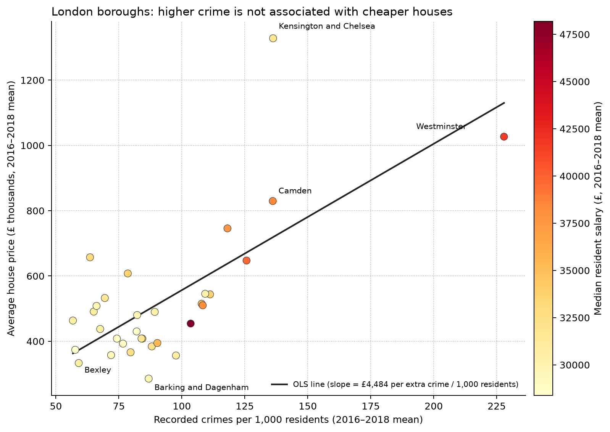
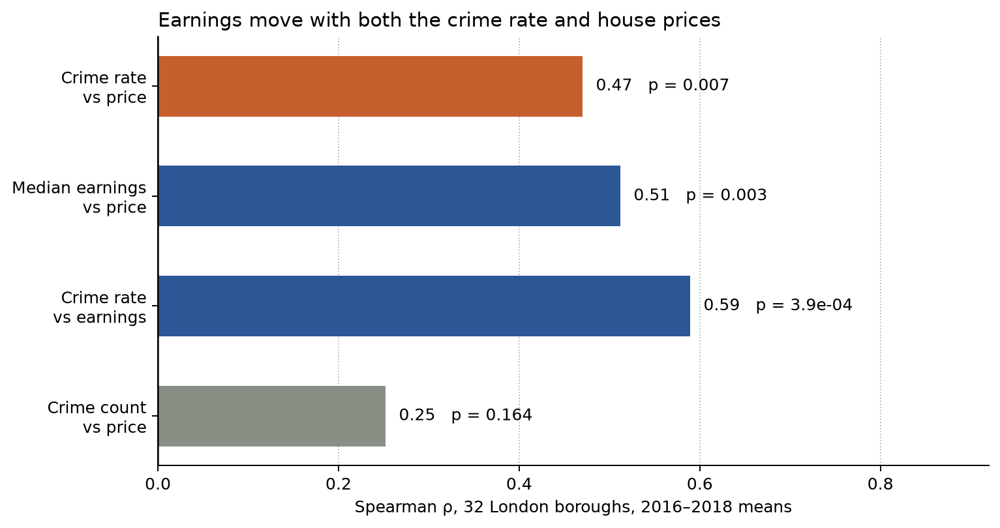

# Crime and house prices in London boroughs

**FANZIQIAN** (Ziqian Fan) · MC63582 · CISC7204 Class A · Team 05

## Research question

In London, do boroughs with a higher recorded crime rate have lower average house prices?

The common-sense claim says yes. On the 2016–2018 means of 32 London boroughs, the claim does not hold.

## Dataset source and usage permissions

The working files are the two tables in the Kaggle dataset [Housing in London](https://www.kaggle.com/datasets/justinas/housing-in-london) by Justinas Cirtautas. That dataset page says the files were extracted from the [London Datastore](https://data.london.gov.uk/) and are released under the [UK Open Government Licence v2 and v3](https://www.nationalarchives.gov.uk/doc/open-government-licence/version/3/).

The house-price series is the Greater London Authority aggregation of HM Land Registry Price Paid Data: [Average house prices](https://data.london.gov.uk/dataset/average-house-prices). Yearly earnings, population, and jobs come from the same London Datastore extract.

This repository includes those public tables and the 32-borough summary built from them. It does not include passwords, API keys, or personal records. The City of London is left out of the 2016–2018 window.

## Methods and tools

Python, pandas, NumPy, SciPy, and Matplotlib, run from `notebooks/01_eda.ipynb`.

Monthly prices are averaged to a calendar year and crimes are summed. A borough-year enters only when crime is recorded for at least 10 months. The crime rate is crimes ÷ population × 1,000. The plotted points are borough means over 2016–2018 (n = 32). Association is Spearman’s rank correlation. A partial Spearman correlation residualises both rank series on the rank of median earnings, then correlates the residuals.

## Key findings

Spearman’s ρ between the crime rate and average price is **0.47** (n = 32, p = 0.007). The association is positive: boroughs with more recorded crime per resident tend to have higher prices, not lower ones.

Median earnings move with both prices (ρ = 0.51) and the crime rate (ρ = 0.59). The raw crime count, without the population adjustment, only reaches ρ = 0.25 (p = 0.16). After earnings are partialled out of the ranks, the crime–price correlation falls from 0.47 to **0.24**.

## Limitation

The result describes 32 boroughs in 2016–2018. It does not show that crime causes high prices, and it does not describe a street or a household. Earnings sit on both sides of the scatter, so the positive ρ is not a clean measure of crime.

## What is in this repository

| Path | Contents |
| --- | --- |
| `notebooks/01_eda.ipynb` | Load, join, rate, correlations, and both figures |
| `data/housing_in_london_monthly.csv` | Monthly prices, sales, and crime totals |
| `data/housing_in_london_yearly.csv` | Annual earnings, population, jobs, and dwellings |
| `data/borough_summary_2016_2018.csv` | The 32-borough table the figures use |
| `figures/crime_vs_house_price.png` | Crime rate against average price |
| `figures/earnings_on_both_sides.png` | Four Spearman correlations on the same boroughs |

## How to run

From the repository root, with Python 3:

```bash
pip install -r requirements.txt
jupyter notebook notebooks/01_eda.ipynb
```

Run all cells. The notebook looks for `data/` in the current directory, then in the parent directory, so it also runs if the kernel starts inside `notebooks/`. It rewrites both PNG files in `figures/`.

## Portfolio

This repository is the project linked from [the portfolio site](https://deoxysd.github.io/data-science-portfolio/). The semester project is ongoing.




